# ⚓ Wellenpfad

**Lerne für den Sportbootführerschein, ohne dass es sich wie Lernen anfühlt.**

Wellenpfad ist ein kleines Rollenspiel im Browser. Deine Crew segelt flussabwärts bis zur Mündung und kämpft gegen
Flussmonster – aber jeder Angriff trifft nur, wenn du eine **echte Prüfungsfrage** richtig beantwortest.

### ▶ [Jetzt im Browser spielen](https://proxforge.github.io/wellenpfad/)

Kostenlos · ohne Anmeldung · ohne Werbung · auf Handy und PC · auch offline

<p>
  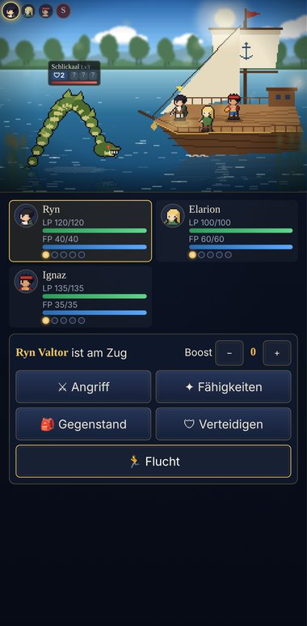
  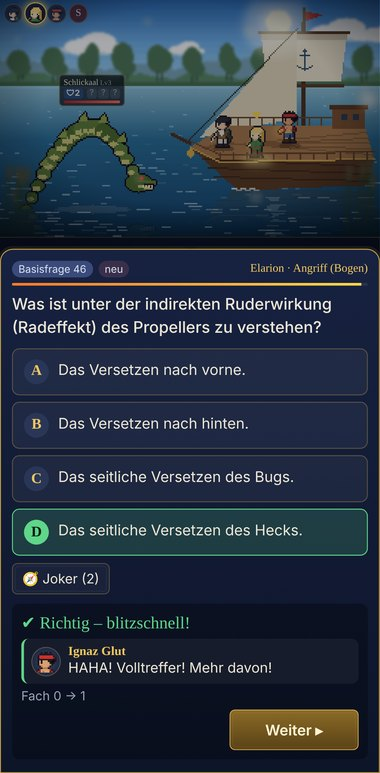
  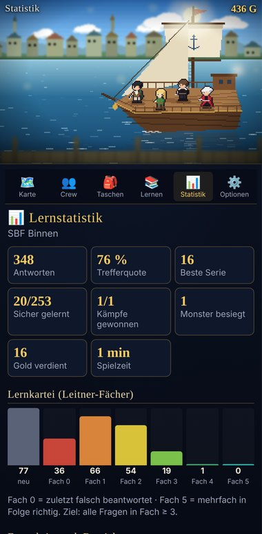
</p>

## Für wen ist das?

Für alle, die den **SBF Binnen**, den **SBF See** oder beide machen und keine Lust haben, Hunderte Fragen stur
durchzuklicken. Enthalten sind **alle 513 Multiple-Choice-Fragen** der amtlichen Fragenkataloge (gültig seit 01.08.2023)
mit ihren Abbildungen: 72 Basisfragen, 181 Binnen-, 213 See- und optional 47 Segelfragen.

Beim Start wählst du, was du lernst: *SBF Binnen*, *SBF See* oder *beides*. Die Segelfragen lassen sich dazuschalten.

---

## Funktionen im Überblick

### Lernen im Kampf

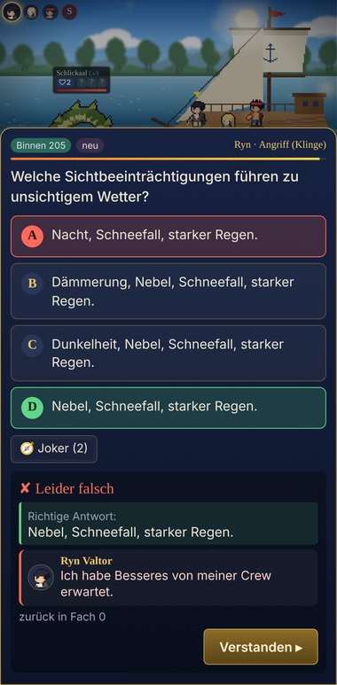

Im Kampf wählst du für jedes Crew-Mitglied eine Aktion: Angriff, Fähigkeit, Gegenstand oder Verteidigen.
Bevor ein Angriff ausgeführt wird, erscheint eine Prüfungsfrage.

- **Richtig:** Der Angriff trifft. Schnelle Antworten (unter 15 Sekunden) und Serien richtiger Antworten machen ihn stärker.
- **Falsch:** Der Angriff geht daneben – und du siehst sofort die **richtige Lösung**.
- **Abwehrfragen:** Holt ein Gegner zu einem großen Angriff aus, halbiert eine richtige Antwort den Schaden.
- **Joker:** Der Lotsenkompass streicht zwei falsche Antworten.

Deine Crew reagiert dabei: Der strenge Kapitän schimpft bei Fehlern, die anderen loben bei richtigen Antworten.

<br clear="right">

### Lernkartei statt Zufall

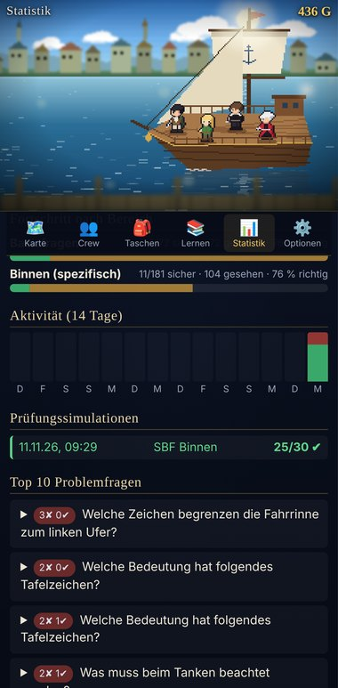

Jede Frage liegt in einem von sechs Fächern. Richtig beantwortet wandert sie ein Fach weiter, falsch zurück auf Fach 0.
Fragen aus niedrigen Fächern kommen häufiger dran, sichere seltener. So übst du automatisch genau das, was noch nicht sitzt.

Die **Statistik** zeigt Trefferquote, beste Serie, die Verteilung auf die Fächer, den Fortschritt je Bereich,
deine Aktivität der letzten 14 Tage, frühere Prüfungen und deine **10 schwierigsten Fragen** – mit einem Knopf, um genau diese zu üben.

<br clear="right">

### Prüfungssimulation

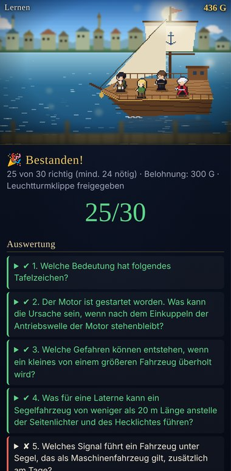

30 Fragen wie in der echten Prüfung: 7 Basisfragen und 23 Fragen aus deinem Bereich. Wie im Original gibt es
erst am Ende eine Auswertung, bestanden ist ab 24 richtigen. Danach siehst du jede Frage mit deiner Antwort und der Lösung.

Im Spiel ist die bestandene Simulation die Voraussetzung für den letzten Bosskampf.

<br clear="right">

### Fragenkatalog und Training

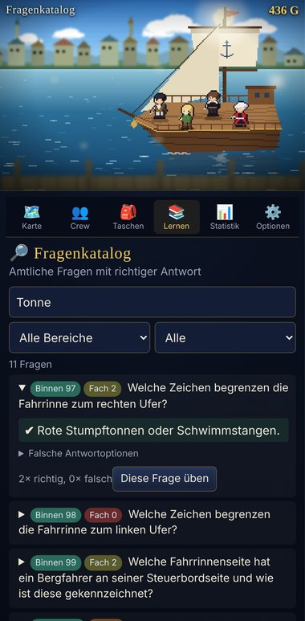

- **Fragenkatalog:** alle Fragen mit Lösung, durchsuchbar nach Text oder Nummer, filterbar nach Bereich,
  Problemfragen, ungesehenen und sicheren Fragen.
- **Schnelltraining:** 10 Fragen nach Lernkartei, ganz ohne Kampf.
- **Problemfragen** und **neue Fragen** gezielt üben.
- Abbildungen (Schifffahrtszeichen, Lichter, Tonnen, Ausweichsituationen) lassen sich per Tippen vergrößern.

<br clear="right">

### Das Abenteuer

<p>
  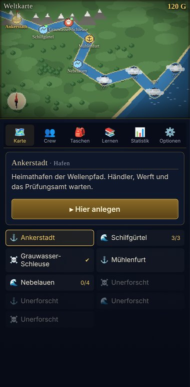
  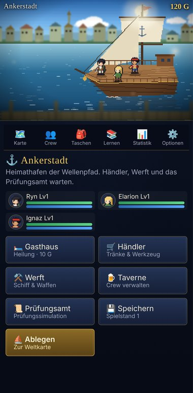
  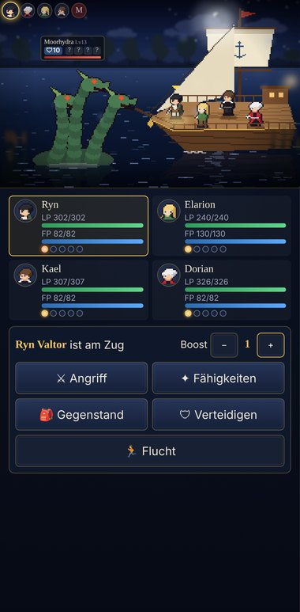
</p>

- **9 Orte** vom Heimathafen bis zur Leuchtturmklippe, mit **3 Bossen**. Neue Orte schaltest du durch gewonnene Kämpfe frei.
- **Häfen** mit Gasthaus (Heilung), Händler (8 Gegenstände), Werft (Upgrades für Waffen, Rumpf, Segel und Seekarten),
  Taverne (neue Gefährten) und Prüfungsamt.
- **Taktische Kämpfe:** Gegner haben Schilde und versteckte Schwachstellen. Triffst du eine Schwäche, sinkt der Schild;
  bei null ist der Gegner kurz außer Gefecht und besonders verwundbar. Mit **Boost-Punkten** verstärkst du Angriffe.
- **Bis zu 7 Crew-Mitglieder** mit eigenen Waffen, Fähigkeiten und Stufen, vier davon gleichzeitig im Einsatz.

### Deine Crew, dein Stil

<p>
  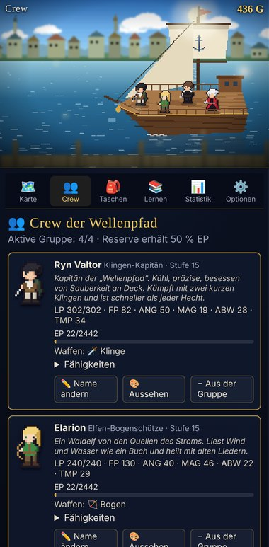
  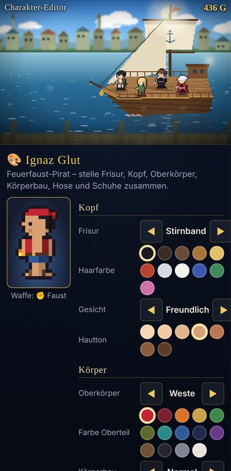
</p>

- **Charakter-Editor:** Frisur, Gesicht, Hautton, Oberkörper, Körperbau, Hose und Schuhe frei kombinieren, jeweils mit Farbwahl.
- **Namen** aller Crew-Mitglieder frei wählbar.
- **Eigene Sprüche** für richtige und falsche Antworten, mit Platzhaltern für Namen und Serien.
- **Realmodus:** Statt Pixelgrafik eigene Fotos für die Crew und eigene Bilder, die bei richtigen und falschen Antworten erscheinen.

### Spielstände

Drei Spielstände, automatisches Speichern und Export/Import unter *Optionen* für den Wechsel zwischen Geräten.

---

## Als App aufs Handy

Seite im Browser öffnen und **„Zum Startbildschirm hinzufügen“** wählen (Safari: Teilen-Menü, Chrome: ⋮-Menü).
Danach startet Wellenpfad wie eine App und läuft auch ohne Internet.

## Deine Daten

Es gibt keinen Server, keine Konten und kein Tracking. Spielstände, Fotos und eigene Texte bleiben **nur in deinem
Browser**. Beim Export werden Spielstand, Namen und Texte übertragen, Fotos nicht.

## Wichtiger Hinweis

Wellenpfad ist ein privates Lernprojekt und **kein offizielles Angebot**. Die Fragen stammen aus den amtlichen
Katalogen des Bundesministeriums für Digitales und Verkehr ([ELWIS](https://www.elwis.de)). Prüfe vor deiner Prüfung den
aktuellen Stand auf ELWIS. Die Navigationsaufgaben (Kartenaufgaben) des SBF See sind nicht enthalten.

---

## Selbst aufsetzen

Wellenpfad ist eine reine statische Webseite: kein Build, keine Abhängigkeiten, kein Backend. Es gibt drei Wege.

### 1. Lokal ausprobieren

```sh
git clone https://github.com/proxforge/wellenpfad.git
cd wellenpfad
python3 -m http.server 8000
```

Dann <http://localhost:8000> öffnen. Vom Handy im selben WLAN erreichst du es über die IP-Adresse des Rechners,
z. B. `http://192.168.0.10:8000`. Jeder andere einfache Webserver funktioniert genauso. Direkt als Datei
(`file://`) geöffnet läuft das Spiel ebenfalls, nur der Offline-Modus nicht.

### 2. GitHub Pages

1. Repository forken.
2. **Settings → Pages → Source: „Deploy from a branch“**, Branch `main`, Ordner `/ (root)`, speichern.
3. Nach ein bis zwei Minuten ist das Spiel unter `https://<benutzer>.github.io/wellenpfad/` erreichbar.

Die Datei `.nojekyll` sorgt dafür, dass GitHub die Dateien unverändert ausliefert. Cloudflare Pages oder Netlify
funktionieren ebenso: Build-Befehl leer lassen, Ausgabeordner `/`.

### 3. Container (z. B. für NAS oder Homelab)

```sh
docker compose up -d --build
```

Danach läuft das Spiel unter <http://localhost:8080>. Das Image basiert auf `nginx-unprivileged` (Alpine, rund 77 MB),
läuft ohne Root-Rechte und schreibgeschützt und liefert nur die Spieldateien aus – README, Tools und Git-Daten nicht.
Ohne Compose: `docker build -t wellenpfad . && docker run -d -p 8080:8080 wellenpfad`.

Für den Offline-Modus und „Zum Startbildschirm hinzufügen“ braucht der Container einen HTTPS-Reverse-Proxy davor
(z. B. Caddy, Traefik oder Nginx Proxy Manager). Im lokalen Netz ohne HTTPS funktioniert das Spiel, nur nicht offline.

### Nach Änderungen

Wer Dateien ändert, erhöht in `sw.js` die Versionsnummer im Namen `CACHE`, damit Geräte die neue Version laden.

### Aufbau

```
index.html            Einstieg
css/style.css         Oberfläche
js/questions.js       Fragendaten (erzeugt mit tools/build_questions.py)
js/gfx.js             Pixel-Renderer: Himmel, Wasser, Schiff, Ebenen mit Tiefenunschärfe
js/sprites.js         Helden, Charakter-Baukasten, prozedurale Monster
js/data.js            Helden, Fähigkeiten, Monster, Gegenstände, Karte, Story, Reaktionen
js/save.js            Spielstände, Lernkartei, Statistik
js/battle.js          Kampfsystem
js/quiz.js            Quizkarte
js/real.js            Realmodus, eigene Bilder und Texte
js/main.js            Bildschirme, Karte, Häfen, Lernen, Statistik
js/audio.js           Musik und Soundeffekte (synthetisch, keine Audiodateien)
sw.js                 Service Worker für den Offline-Modus
assets/q/             Abbildungen zu den Prüfungsfragen
docs/screenshots/     Bilder für diese Seite
tools/                Skripte zum Aufbereiten von Fragen und Abbildungen
Dockerfile, nginx.conf, docker-compose.yml   Container-Variante
```

### Fragen und Abbildungen aktualisieren

Die Skripte in `tools/` brauchen Python 3; `repair_images.py` zusätzlich Pillow (`pip install pillow`):

```sh
# Fragen aus der JSON-Aufbereitung erzeugen
python3 tools/build_questions.py <pfad>/sbf-see-binnen-fragenkataloge/src/data/questions.json <pfad>/sbf-see-binnen-fragenkataloge/public
# Abbildungen durch die ELWIS-Originalgrafiken ersetzen und prüfen
python3 tools/repair_images.py <pfad>/fragenkatalog_sportbootfuehrerschein <pfad>/FuehrerscheinApp
```

Quellen: Texte aus [IAL32/sbf-see-binnen-fragenkataloge](https://github.com/IAL32/sbf-see-binnen-fragenkataloge)
(nur die amtlichen deutschen Texte), Abbildungen aus
[koljabohne/fragenkatalog_sportbootfuehrerschein](https://github.com/koljabohne/fragenkatalog_sportbootfuehrerschein) und
[deveth0/FuehrerscheinApp](https://github.com/deveth0/FuehrerscheinApp).

## Lizenz

Code: MIT (siehe [`LICENSE`](LICENSE)). Prüfungsfragen und Abbildungen sind amtliche Werke und davon ausgenommen.
